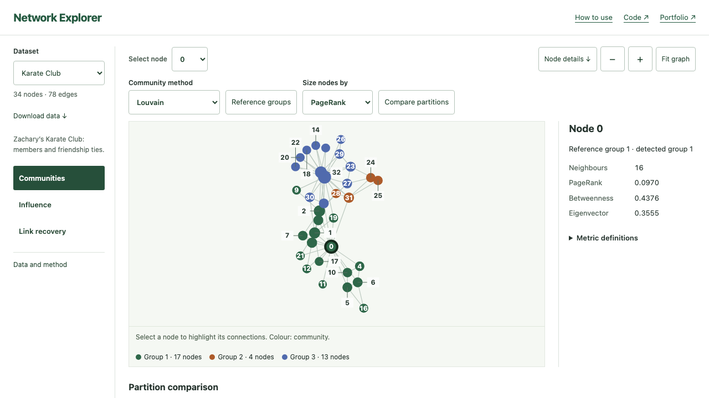

# Network Structure Explorer

**How do community structure and node position affect influence and missing-link recovery?**

[Open the explorer](https://network.m21264551.com) · [Case study](docs/case-study.md)



## Walkthrough

1. Use **Compare partitions** to inspect the Karate Club reference groups beside a community algorithm. Both panes share coordinates, pan/zoom and node selection.
2. Switch to strong or weak planted groups and inspect where agreement breaks down.
3. Compare seed strategies across paired propagation trials. Step through a saved cascade.
4. Examine missing-link recovery across 20 outer splits, including cases where a learned model loses.

Every count, partition, metric, summary, replay and download comes from `data/experiments.json` (schema v1). Browser controls select bounded precomputed experiments; no analysis server is required. Keyboard node selection and persistent details accompany the graph.

## Data and protocol

- **Karate Club:** NetworkX's copy of Zachary's 34-person, 78-edge network. Reference labels describe the subsequent club split, not a unique correct partition. [Source and citation](https://networkx.org/documentation/stable/reference/generated/networkx.generators.social.karate_club_graph.html).
- **Strong SBM:** four groups of 20, within-group probability 0.30, between-group probability 0.015.
- **Weak SBM:** four groups of 20, probabilities 0.18 and 0.08.

Graphs are unweighted and undirected. Generation, layout and algorithm seeds are fixed and exported. Louvain and label propagation choose partitions; Girvan–Newman and spectral clustering receive the reference group count. Spectral clustering embeds the smallest non-trivial normalized-Laplacian eigenvectors then applies k-means. Modularity evaluates internal connectivity; NMI/adjusted Rand evaluate agreement with reference labels. They are not interchangeable.

Link recovery holds out approximately 15% of edges over seeds 0–19 while preserving connectivity. Negatives are balanced true non-edges from the original graph. Held-out pairs never enter training negatives. Features are recomputed on each split's remaining graph; a positive training pair's own edge is temporarily removed. Min/max endpoint features make undirected pairs invariant to endpoint order. The fixed gradient-boosting challenger uses 200 estimators, depth 3 and learning rate 0.05. There is no row-wise CV over cached topology features.

Independent Cascade compares PageRank, degree, betweenness and one fixed random seed set. Each seed count (1/3/5) and propagation probability (0.05/0.1/0.2) has 100 paired directed live-edge worlds. Strategies see the same world within a trial. Reported spread variability is a standard deviation, not a confidence interval or observed human behaviour.

## Reproduced results

Mean ROC-AUC across the 20 outer splits:

| Dataset | Highest mean | Gradient Boosting | Interpretation |
|---|---|---|---|
| Karate Club | Preferential Attachment 0.768 | 0.690 | The simple degree-product heuristic wins here. |
| Strong SBM | Jaccard 0.751 | 0.716 | Local overlap contains a recoverable signal. |
| Weak SBM | Jaccard 0.500 | 0.493 | None of these methods establishes useful recovery on this graph. |

The explorer reports standard deviations and every split, not just the means. These are repeated partitions of three fixed graphs, not independent population samples. Changing graph weights, algorithm information or split rules changes the question and can change the ranking.

## Reproduce and verify

Python 3.11 and Node 20:

```sh
python -m venv .venv
source .venv/bin/activate
pip install -r requirements-reproduce.txt
pip install -e . --no-deps
python main.py --export-dashboard data/experiments.json
python -m pytest -q
python -m http.server 8087
```

For browser checks in another terminal:

```sh
npm ci
npx playwright install chromium
npm run test:unit
npm run test:browser
npm run build
```

The existing analysis CLI and LFR generator remain available (`python main.py --help`). The export records code revision, source checksum, dataset checksums, seeds, parameters, graph coordinates, exact partitions, all split pairs, scores and diffusion reaches. Timestamps and code revisions differ between exports; the numerical experiments are deterministic in the pinned scientific environment.

Tests cover generation determinism, graph/attribute preservation, valid negative sampling, absent held-out edges, symmetric features, paired cascades, export consistency and UI/download parity. Browser checks cover keyboard node inspection, relevant controls, missing-data recovery, mobile layout and axe accessibility. Display-colour matching maximizes membership overlap without relabelling the saved partitions. CI also checks synchronized comparison, viewport and focus preservation.

## Limits and tradeoffs

The static bundle makes publication auditable and browsing cheap. It deliberately limits visitors to curated experiments. Connectivity preservation excludes bridge edges from the link task; balanced negatives do not represent real missing-link prevalence. Training edges are locally removed for features, but a single static graph still differs from a temporal prediction task. The synthetic groups are planted by construction. More complex models or visually attractive partitions are not automatically better.
